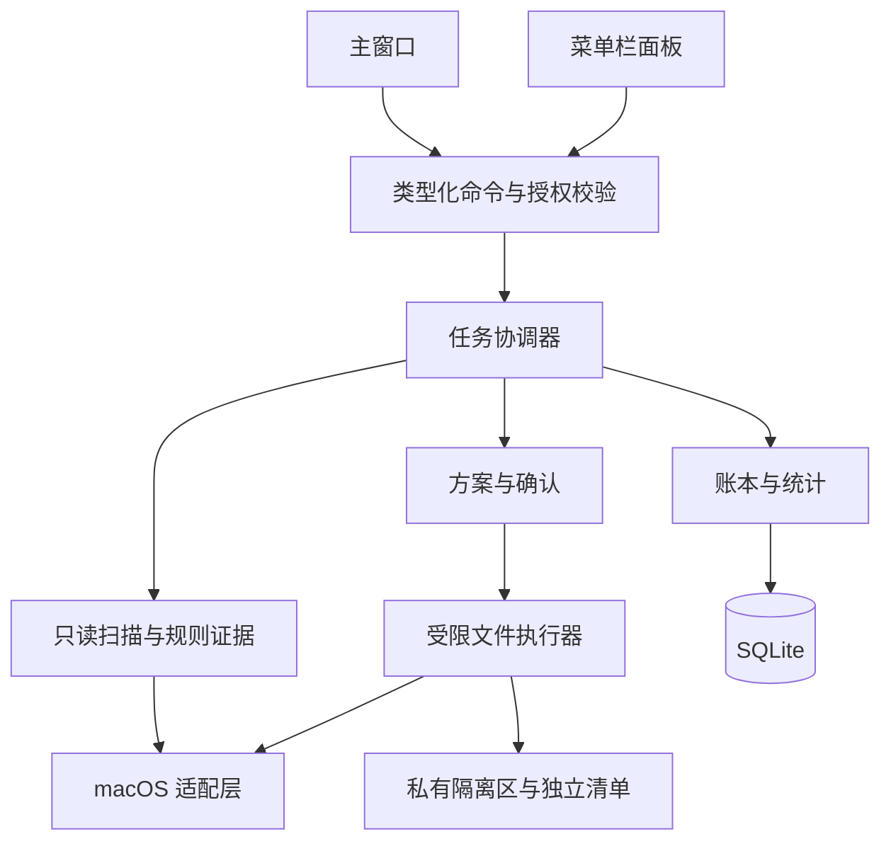

# 澄清：开发方案

更新日期：2026-11-03。状态：后续原生桌面版的实现建议，尚未开发。

当前界面与行为以 [index.html](../index.html) 为依据，产品结构与交互见[产品设计](product-design.md)。本文集中维护技术边界、数据契约和交付顺序，不重复页面说明。以下建议不表示原型已经具备真实清理能力。

## 1. 当前基础与开发范围

当前是单文件 HTML/CSS/JavaScript 原型。固定 `files` 数组和全局 `S` 保存演示数据；扫描由计时器推进，隔离、恢复和删除只修改内存状态。菜单栏面板是同一页面里的弹层，容量、CPU、内存、证据和路径均为示例。

只有主题偏好尝试通过 `localStorage` 跨刷新保存；范围、选择、隔离、待处理、记录、供应商配置和 API Key 均为会话状态。当前已有供应商配置、格式检查和示例建议交互，但没有真实模型调用，也没有 React、Tauri、Rust、SQLite、原生权限或文件操作。

主窗口当前默认为 386 × 617 px；开始扫描或已有扫描记录时切换为 1000 × 617 px，宽度受视口约束，内部按容器宽度响应。内容区统一滚动，处理按钮随内容排列。设置与 AI 建议使用独立浮动对话框，初始分别为 560 × 640、640 × 560 px，支持视口内缩放与本次会话尺寸记忆；这些仍是浏览器布局，不是原生多窗口。

后续建议先交付本地只读扫描与少量经验证的软件规则，再实现同卷隔离、恢复和持久化记录，最后开放永久删除与空间复核。原型示例路径不能直接成为生产操作规则；未支持的检查范围明确标记，不能展示为已完成。

建议先面向 macOS、普通用户可访问的目录。具体最低系统版本、首批软件、硬件支持和分发渠道在可行性验证后确定；自动清理、到期清空、root 服务、账户、云同步和跨平台不纳入这一开发起点。

## 2. 桌面外壳与技术分层

建议采用 React + TypeScript + Tauri 2 + Rust + SQLite：复用现有视觉与交互，Rust 管理扫描事实和文件权限，SQLite 保存方案与事件。具体依赖和版本在启动工程时验证并固定。

原生应用只承载窗口内容；网页中的系统菜单栏、桌面背景和交通灯不直接搬进应用。系统窗口控制交给 macOS，菜单栏采用真实状态图标与定位面板；焦点、全屏空间和多显示器行为需要实机验证。

前端提供演示与真实服务两个适配器，开发时可复用演示数据；正式构建明确连接真实服务。原 `index.html` 保留为交互对照，真实业务不继续依赖全量 `innerHTML` 重绘。

界面只展示事实、收集选择和管理视图草稿。平台层封装系统机制，不自行决定可删；模型没有执行接口。主窗口和菜单栏共享后端事实、规则、执行器和账本，各自保留视图与方案草稿，快捷扫描不覆盖主窗口已审阅的快照。

任一时刻只运行一个修改文件的任务；写操作与重叠目标的扫描不并行。关闭窗口与退出进程的行为另行确定；退出不能强行中断后报告完成，重启后必须核对未终结操作。

## 3. 最小数据与通信契约

范围、类别、建议、执行条件分别建模，不复用单个 `type` 或 `ready` 表示所有判断。建议保留不等于不可选择，选择也不等于获得执行许可。

| 对象 | 必须保留的信息 |
| --- | --- |
| 扫描快照 | scanId、范围与规则版本、开始结束时间、逐范围覆盖状态、取消或缺失原因 |
| 项目与证据 | itemId、snapshotId、归属、类别、大小口径、数量、证据来源与时间、未知信息、建议和影响 |
| 文件清单 | manifestId、成员、卷与文件身份、类型、大小和时间等核验信息；确认后不扩大成员集合 |
| 方案与确认 | planId、revision、manifest 摘要、所选与保留、方式、待处理原因；确认摘要、来源、期限和消费状态 |
| 操作与事件 | operationId、requestId、executionId、batchId、文件生命周期、意图、逐项实际结果、错误与时间序号 |
| 隔离条目 | vaultId、来源批次、原路径与当前路径、身份清单、恢复元数据、限制和当前占用 |
| 空间测量 | volumeId、metricKind、前后样本与时间、测量区间、覆盖的删除事件、观测净变化和干扰状态 |

文件身份结合卷、文件编号、类型、时间和清单，不能只依赖路径或认为 inode 永不复用。硬链接的实体与目录项分开处理；恢复后再次删除属于新的操作生命周期。

大小以整数字节存储，跨 JavaScript 边界使用十进制字符串，在后端去重和加总；GB 与 GiB 明确区分。时间保存 UTC 绝对值，按用户本地时间展示和筛选。历史批次保存审阅快照，不能回查当前文件数组还原旧判断。

通信按以下职责划分，具体命令名与 schema 在工程启动时固定：

- 查询：系统概览、范围状态、分页扫描结果、项目证据、隔离条目、历史、设置与模板总结。
- 扫描：按合法 scopeIds 启动或取消，范围由后端解析，不接收任意扫描根路径。
- 方案：按本地 itemId 与 snapshotId 准备处理方案；恢复和清除按 vaultId 另建方案。
- 执行：登记确认、提交固定方案、停止尚未开始的项目；恢复新位置由原生选择器产生受限目标引用。
- 任务：返回 taskId、sequence、阶段、已完成量和可空总量；支持重连后按序补齐已落账事件。

进度与清单分离，列表分页，避免逐文件全量重绘。未知总量显示阶段和已检查量，不能用时间制造真实扫描百分比。通知 UI 成功前，实际结果必须已落账。

## 4. 扫描、规则与方案准备

扫描只读枚举允许范围，排除应用自身账本和隔离区。保存应用内部扫描状态不等于修改待清理目标。取消、权限不足、未知和未支持各自记录，只提交证据完整的项目。

规则使用受 schema 约束的数据，包含版本、适用软件、受限根引用、相对范围、排除项、类别、重建依据和前置条件；规则不携带 shell 脚本。归属、可重建边界和适用版本不明确的内容不能因名称含 Cache 就推荐清理。

默认不跟随符号链接，不为测量大小下载云占位内容，不默认读取聊天、密码和文档正文。包目录、挂载点、硬链接和 APFS 克隆采用明确策略；未知占用不能写成 0。

未发现打开句柄不等于保证无人使用。对支持的缓存结合应用状态、目录稳定性和规则证据判断；条件不能核实时保留为待处理。旧运行时、共享依赖和离线模型优先由所属软件管理。

筛选、搜索和排序只改变视图，隐藏选择在审阅中完整呈现。方案按固定成员清单去重，消除父子目录与多规则重叠；新生成的文件不自动进入旧确认。待处理条件解除后重新检查并确认，不自动执行保存过的计划。

快捷入口仅处理白名单中的可重建缓存，提供影响说明后确认隔离。新扫描与复用已有扫描采用一致范围口径，复用时展示来源和时间；菜单栏不提供永久删除。

## 5. 确认、幂等与执行协议

1. 后端根据固定方案生成最终摘要，绑定方案版本、项目与 manifest、处理方式、目标、来源窗口和有效期。内容变化使旧确认失效；HTML 复选框不能单独成为执行授权。
2. 高风险操作采用后端控制的最终确认，展示真实范围与恢复限制；普通隔离也须登记确认并进行后端复查。确认不能被解释为对已被控制的同权限界面的完整防护。
3. 收到执行请求先按 requestId 查找既有任务；重试返回原 executionId，即使原确认已经消费。新任务的创建、请求登记与一次性确认消费在同一数据库事务完成。
4. 事务提交后逐项复查规则、边界、身份、目录成员、权限、应用状态和相关引用。变化项停止并要求重审，不扩大范围。
5. 先可靠保存操作意图与恢复清单，再变更文件，随后核验并保存实际结果。数据库事务不包含文件系统操作，不承诺整个批次自动回滚。
6. 分别记录成功、待处理、跳过、失败和待核对。停止只影响尚未开始的项目；部分成功保留真实记录，隔离失败不降级为直接删除。

文件操作通过目录句柄、相对操作和不跟随链接等机制收紧范围，防止路径替换。一次 `realpath` 检查不能覆盖后续竞态；持续变化或无法验证的目标停止处理，不能用文案承诺不存在的排他保证。

单项状态至少区分：已准备 → 已确认 → 复查 → 意图已保存 → 操作中 → 已核验 → 已记账；条件不足进入待处理，范围变化进入待重审，中断或证据冲突进入待核对。

## 6. 隔离、恢复与故障核对

首阶段仅隔离同一文件系统内、规则已验证的普通文件。默认按确认清单逐成员移动，保留目录结构、原位置、权限和扩展属性等恢复信息；隔离内容禁止执行，不参与后续扫描。

隔离目录为应用私有，独立清单保留恢复所需信息。操作采用明确不覆盖目标的移动策略；普通 rename 可能覆盖目标，不能直接视为安全封装。跨卷或 `EXDEV` 停止并保留原物，不隐式复制后删除。

整体目录移动仅作为经过验证的优化。若发现未确认成员或内容变化，停止后续处理，尝试经不覆盖核验的返还；不能安全返还时保留清单并转人工核对，不计成功，也不允许清除异常条目。

恢复另建方案，检查原卷、目标权限、身份和同名冲突。默认不覆盖，可选择新名称、新位置或跳过；改变目标重新确认。恢复成功不保证外部软件的数据库、同步状态和业务上下文回到过去。

直接删除和隔离清除共用逐成员机制，严格限定在确认清单。新成员或身份变化使相关处理停止；部分失败保留剩余条目及清单。彻底清除不代表安全擦除，也不保证对应磁盘空间立即可用。

启动时先核对未终结意图：

- 移动类操作按其实际方向确定预期来源与目标；仅目标存在且身份符合，可补记完成；仅来源存在且身份未变，记未完成。
- 两边均存在、两边均缺失或身份冲突，进入待核对，不推断成功。
- 删除中断后核对逐成员记录；路径缺失本身不足以证明由本次操作删除，证据不足不补计成功，也不自动重试删除。
- 数据库损坏、磁盘满或无法可靠记录意图时禁用新写操作，保留独立清单用于人工恢复和账本重建。

## 7. 账本与空间统计

批次保存审阅时的选择、保留、证据和确认范围。恢复、清除追加到来源批次，不覆盖原事件；请求、操作和事件具有唯一约束，窗口重连不能重复写入同一事实。

| 指标 | 口径 |
| --- | --- |
| 已发现／已选占用 | 确认范围内去重后的文件占用估计，不是保证可释放量 |
| 本次隔离占用 | 本次实际隔离成功的占用；同卷仍占空间 |
| 当前隔离存量 | 全部批次当前仍在隔离区的占用，不受期间筛选影响 |
| 本期删除／恢复占用 | 按实际事件时间分别统计；隔离后清除只计一次删除事实 |
| 已复核磁盘净变化 | 同卷、同 metricKind 的 availableAfter − availableBefore，可为负数 |

待处理、跳过、失败、保留和待核对不计成功。期间内创建或发生事件的批次均可展示，批次初始大小不能冒充本期成功量。总结由代码计算，再套模板；恢复量不等于负删除量。

磁盘净变化是观测值，受其他写入、快照、可回收空间与延迟回收影响，不能宣称精确因果收益。测量记录口径、时刻、质量与干扰状态；未发现干扰不等于没有干扰，未测量显示未复核。

每个测量区间记录覆盖的删除事件，同卷累计区间不重叠；不能按区间内每个事件重复累加净变化。跨期间的测量按完成时间展示归属，并保留覆盖事件时间。硬链接和克隆的分配占用也不是保证释放量。

## 8. 权限、系统状态与发布

应用以普通用户运行，前端不获得任意文件、shell、SQL 或密钥能力。主窗口与菜单栏分别授权；自定义命令显式配置权限，同时在后端检查来源窗口、参数、方案和确认。快捷面板仅获缓存扫描与隔离权限。

正式界面只加载打包资源，约束导航和远程内容；文件名、日志与模型文本作为数据安全渲染。规则或内容中的指令不能改变权限。凭据进入平台安全存储，日志与诊断默认不包含原始用户内容、敏感清单和模型密钥。

Full Disk Access 不代表可访问所有文件，系统保护、ACL 和容器限制仍可能生效。按范围展示授权和覆盖状态；目标系统、签名安装、菜单栏与多显示器行为通过真机验收后才声明支持。

磁盘读数标明口径和采样时间；无法解释的已用空间不能直接命名为系统占用。CPU 按采样差计算，内存明确口径，隐藏面板降低采样频率；具体刷新频率和性能目标待实测确定。

发布前验证签名、公证、安装、权限、升级和迁移。更新前等待写任务终结，迁移前备份；失败保留数据进入只读诊断，不自动清空。回退程序须兼容数据 schema，规则更新不能静默扩大已确认方案。

## 9. AI 配置演示与后续接入

### 当前实现

设置默认打开“供应商配置”，另有“外观主题”页签。预设如下；这些是 HTML 内置示例，不表示账户、模型或服务已通过验证。

| 供应商 | 示例模型 | 基础地址 | Key |
| --- | --- | --- | --- |
| OpenAI | `gpt-4.1-mini` | `https://api.openai.com/v1` | 必填 |
| DeepSeek | `deepseek-chat` | `https://api.deepseek.com/v1` | 必填 |
| Anthropic | `claude-sonnet-4-20250514` | `https://api.anthropic.com/v1` | 必填 |
| 通义千问 | `qwen-plus` | `https://dashscope.aliyuncs.com/compatible-mode/v1` | 必填 |
| Ollama | `llama3.2` | `http://127.0.0.1:11434/v1` | 可选 |
| 自定义接口 | 空，需填写 | 空，需填写 | 可选 |

`AI` 初始为 `enabled=false`、`defaultId=null`、空配置。首次保存合法配置自动设默认并启用示例建议，没有独立启停开关；后续可保存多个供应商并选择默认。移除默认时按预设顺序选剩余配置，全部移除后关闭。建议就绪只判断已启用且默认配置存在，不要求通过测试。

保存记录 `id/key/model/endpoint/formatChecked`，裁去首尾空白和地址末尾斜杠；草稿另存测试状态及由地址、模型和 Key 序列化得到的匹配指纹。字段修改使测试状态失效；该指纹不是加密摘要。配置、明文 Key 和草稿只存在前端内存／表单 DOM，不写入 `localStorage`，刷新清空；密码输入框支持显示与隐藏，尚未接入安全凭据存储。

“测试连接”实际仅校验必填 Key、非空且不含空白的模型 ID，以及无用户名密码、查询串或片段的 HTTP(S) 基础地址；当前没有把远程地址限定为 HTTPS。合法后约 700 ms 显示格式通过，未验证网络、密钥权限或模型可用性。可不测试直接保存；`formatChecked` 只表示该配置的演示格式检查状态。

当前可见的“询问 AI”入口仅在单项行内详情，预览摘要含应用、类别、大小、建议与条件，不含文件正文、完整路径或密钥。源码另有扫描前范围和结果总览模板，但没有对应的可见入口。生成按钮约 650 ms 后用本地规则和模板组合示例，不更改勾选或文件状态。关闭、切换供应商或修改相关配置会取消未完成的演示任务，版本标记阻止旧回调覆盖新界面。测试与示例生成均没有网络请求；控制台外链由用户另行打开。

### 后续真实接入建议

本地扫描、规则、执行和模板总结继续独立于模型。真实网络调用移入后端网关，非敏感配置与凭据分开持久化，Key 使用平台安全存储；地址协议、目标范围与本地服务鉴权单独校验，格式检查和真实连通性测试分开记录。

用户启用后只发送必要的脱敏元数据与证据摘要。模型仅辅助理解意图、受控只读补查、影响解释和总结，输出引用当前 itemId 与 evidenceIds，并经 schema、枚举、存在性和状态校验；不得提交自由路径、通配符或 shell，也不拥有文件操作工具。数字和成功状态始终来自代码与真实事件。

失败、冲突或证据不足回退规则与待确认。是否增加分类或分流模型，先以独立人工样本旁路比较误推荐、拒绝判断、延迟和成本；版本更新重测，保留关闭与回退能力。当前供应商选项不等于已实现相应协议适配，真实供应商和部署方式仍待验证。

## 10. 开发顺序与退出条件

| 阶段 | 交付与退出条件 |
| --- | --- |
| A 原生可行性 | 窗口、真实菜单栏、权限探测、安装与同卷移动恢复实机验证；确定系统和分发范围 |
| B 界面与只读扫描 | 可并行迁移界面和建立少量规则；演示与真实服务明确，扫描不修改目标，缺失覆盖可见 |
| C 隔离、恢复与账本 | 确认绑定、幂等、冲突恢复、逐项结果、重启核对通过后，才开放真实写操作 |
| D 删除、空间复核与总结 | 逐成员部分失败、隔离后清除、恢复后重删、跨期事件和测量去重验证通过 |
| E 发布验证 | 实际软件、系统与硬件组合完成安装、签名、升级、权限和故障回归；发布包无测试控制入口 |

依赖为 A → B → C → D → E；可选 AI 独立评估。工期、性能预算和具体目录拆分在可行性验证与样本规模明确后安排，不在当前文档中承诺。

文件引擎使用应用自建临时样本验证，重点覆盖符号链接替换、父子重叠、硬链接、目录新成员、确认过期与重放、移动后未记账、部分删除、数据库错误和磁盘满。界面还需验证主题、焦点、隐藏选择和主操作可达；浏览器演示不能替代原生权限与文件系统验收。
