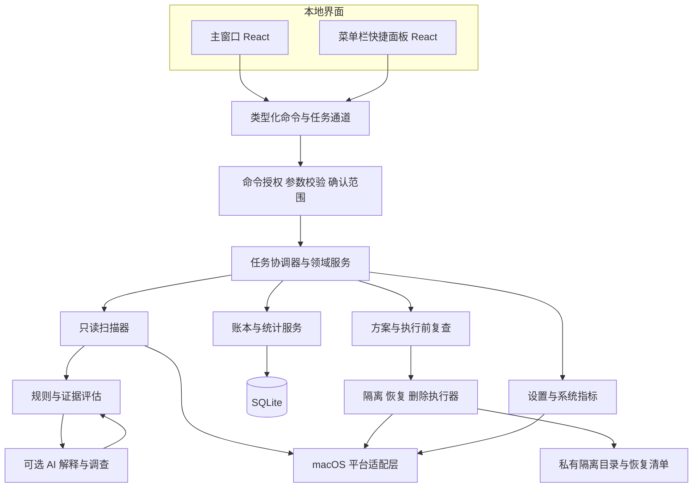
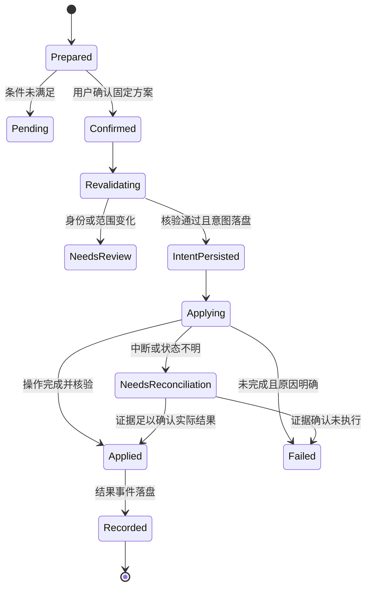

# 澄清桌面端技术架构设计

日期：2026 年 11 月 2 日

状态：开发建议稿

界面与实施依据：[桌面端实现方案](desktop-implementation.md)

AI 专题：[本地证据与 AI 架构](ai-architecture.md)

核心架构建议采用 **React + TypeScript + Tauri 2 + Rust + SQLite**。界面负责呈现和收集选择，Rust 服务拥有扫描事实、规则和操作权限，SQLite 保存账本，macOS 适配层封装系统差异。首版本地运行即可完成清理闭环，AI 和云端服务均为可选扩展。

## 1 技术选型与取舍

| 层次 | 建议技术 | 选择依据与边界 |
| --- | --- | --- |
| 桌面外壳 | Tauri 2 | 复用当前 HTML/CSS 设计，连接 Rust 服务、窗口和菜单栏 |
| 界面 | React、TypeScript、Vite | 组件化迁移原型，类型约束接口；只打包本地界面资源 |
| 前端状态 | Zustand 管理视图草稿，类型化服务客户端访问业务状态 | 不把文件处理真相交给前端 store；暂不叠加多套请求缓存框架 |
| 本地核心 | Rust、Tokio、受限阻塞线程池 | 领域模型与系统调用集中维护；枚举和文件 I/O 不阻塞界面线程 |
| 存储 | rusqlite、SQLite、本地迁移脚本 | 单机结构化记录与事务；只允许 Rust 访问数据库 |
| 平台能力 | Rust 平台适配器，必要时少量 Objective-C/Swift 桥接 | 封装 AppKit、Foundation、Keychain 等，不再实现第二套业务引擎 |
| 验证 | Rust 集成测试、Vitest、界面自动化、macOS 实机测试 | 优先验证文件范围、恢复、中断与统计，不以覆盖率替代正确性 |
| 发布 | Developer ID 签名、公证、DMG、签名更新包 | 首版建议官网分发；发布密钥与应用数据分开管理 |

Tauri 在核心进程中管理应用状态，界面运行在 WebView；不需要为首版额外启动 Node 服务或本地 HTTP 服务。[Tauri 进程模型](https://v2.tauri.app/concept/process-model/)

### 1.1 框架比较

| 方案 | 对当前项目的收益 | 主要代价 | 建议 |
| --- | --- | --- | --- |
| Tauri 2 + React + Rust | 当前样式和交互可迁移，界面与受控本地引擎分离 | 团队需同时掌握前端、Rust 与 macOS；菜单栏行为要实机验证 | 默认建议 |
| SwiftUI + AppKit | 适合长期专注 macOS、团队已有 Swift 能力的情况 | 需重写当前 Web 界面，跨平台时另行实现 UI | 明确只做 macOS 且原生团队成熟时采用 |
| Electron + React | 适合已有成熟 Electron 工程和 Node 原生能力的团队 | 需要管理 Chromium/Node 运行时，仍需专门实现可靠文件引擎 | 团队已有相应资产时再考虑 |

以上是针对本项目设计资产和开发组织的工程取舍，不将框架本身等同于文件处理可靠性。最低系统版本和依赖精确版本在 M0 试验后锁定，并持续接收安全补丁。

## 2 系统分层与运行结构



前端只能发出经过约束的业务请求，不能直接读写任意路径、执行 shell、操作数据库或持有模型密钥。文件系统操作只经过执行器；平台适配层只封装机制，不独立作清理决策。

核心进程内划分异步任务、受限文件扫描线程池、单一写操作队列和数据库写入队列。主窗口关闭但进程仍运行时任务可继续；进程退出后不承诺任务继续，由下次启动核对。待需更强故障隔离时，再将执行器拆为受认证的独立进程，首版不增加常驻特权 helper。

### 2.1 模块职责

| 模块 | 主要职责 | 不承担的职责 |
| --- | --- | --- |
| `platform_macos` | 软件发现、卷信息、权限结果、原生窗口配合、系统采样 | 不按路径名称自行决定可删 |
| `scanner` | 在允许范围枚举、采集身份与占用、形成快照与覆盖报告 | 不移动或删除目标 |
| `rules` | 归属、类别、推荐、前置条件与支持的处理方式 | 不接收可执行脚本型规则 |
| `evidence` | 保存检查来源、时间、版本、缺失和不确定性 | 不把“没发现引用”写成“保证无人使用” |
| `plans` | 草稿、去重、复查、方案版本、确认摘要 | 不凭前端 ready 标志放行 |
| `executor` | 校验、隔离、恢复、删除、单项结果、中断协调 | 不因隔离失败切换为删除 |
| `ledger` | 不可变操作事件、状态投影、空间采样与汇总 | 不把计划量计入已处理 |
| `ai_gateway` | 脱敏、供应商适配、受控只读补查、结构化解释 | 不拥有执行接口 |

## 3 数据模型与本地存储

### 3.1 领域对象

| 对象 | 必需字段或关系 |
| --- | --- |
| `ApplicationIdentity` | bundle ID、安装位置、版本、签名归属证据、发现时间；允许多个安装副本 |
| `ScanRun` | scanId、范围配置快照、规则版本、开始结束时间、逐范围覆盖状态、取消原因 |
| `ScanItem` | itemId、scanId、snapshotId、应用归属、文件类别、范围标签、逻辑大小、分配占用估计、数量和缺失信息 |
| `FileManifest` | manifestId、成员相对路径、volumeId、文件身份、类型、size、mtime/ctime、可用的生成信息及摘要 |
| `EvidenceSnapshot` | evidenceId、itemId、检查时间、来源、支持版本、进程/依赖检查结果、unknown 原因 |
| `Advice` | recommendAction、impact、preconditions、evidenceIds、ruleVersion、可选模型版本；不等于执行许可 |
| `Plan` 与 `PlanItem` | planId、revision、snapshotId、manifestHash、method、所选/保留、待处理原因和最终审阅摘要 |
| `Confirmation` | planDigest、处理方式、确认时间、确认来源、有效期、一次性授权状态和 executionId |
| `Operation` 与 `ExecutionEvent` | operationId、幂等键、batchId、文件生命周期标识、意图、实际结果、错误、事件时间和序号 |
| `VaultEntry` | vaultId、隔离路径、原路径、身份清单、来源批次、当前状态、恢复限制和实际占用 |
| `SpaceSample` | sampleId、volumeId、metricKind、总量/可用量、测量时刻、测量质量、关联测量区间 |
| `MeasurementWindow` | measurementId、前后样本、覆盖的删除事件、净变化、干扰状态 detected/unknown/controlled |

范围、类别、建议与执行条件分别建模。例如“卸载残留”属于归属状态，“模型资源”属于类别，“建议保留”属于建议，“由所属应用处理”属于执行条件，不能合并成一个 `type` 或 `ready`。

大小在 Rust 和 SQLite 中以整数字节保存，跨界面接口以十进制字符串传输，避免 JavaScript 整数精度损失。GB 按十进制格式化，若使用 GiB 则明确标单位；加总在 Rust 完成。时间保存 UTC 绝对时间，按用户本地时区显示和筛选。

文件身份不能只用路径，也不能把 inode 当作永不复用的 ID。身份核对结合卷、文件编号、类型、时间与 manifest；有硬链接时区分“文件实体”和“路径目录项”。不同扫描快照可引用同一实体，但新的删除生命周期使用新的操作标识，避免误计和重复执行。

### 3.2 表与关系

建议表包括 `applications`、`scan_runs`、`scan_scopes`、`scan_items`、`manifests`、`manifest_members`、`evidence`、`advice`、`plans`、`plan_items`、`confirmations`、`requests`、`executions`、`batches`、`operations`、`execution_events`、`vault_entries`、`space_samples`、`measurement_windows`、`measurement_events` 和 `settings`。

关键约束：请求表中的 `requestId` 唯一；`operations.idempotency_key` 唯一；`execution_events(operation_id, sequence)` 唯一；每个实际删除事件只能归入一条计数关系；同一操作事实不能被窗口重连重复插入。批次存审阅时的快照，不回查已经变化的“当前文件数组”还原历史。

数据库保存在 `~/Library/Application Support/Chengqing/`；隔离内容在同根的独立 `Vault/<batchId>/<vaultId>/` 下。日志不包含原始用户内容和模型密钥；凭据进入 macOS Keychain。隔离清单含原路径，按敏感本地数据保护，不随诊断默认上传，也不默认从备份机制排除。

SQLite 建议 WAL、单写入者和短事务；操作意图及结果采用满足故障恢复要求的同步策略。WAL 可让读取与写入较好地并行，但仍需处理锁竞争、检查点和数据库满等错误。[SQLite WAL](https://www.sqlite.org/wal.html)

活跃数据库备份使用受支持的备份流程，不能只复制 `.db` 而遗漏未检查点的数据。每次升级前校验迁移和兼容性；高频明细按批写入，设置扫描历史保留策略，隔离文件不会因历史清理自动消失。

## 4 类型化通信与权限边界

### 4.1 主要命令

以下为业务接口草案，命名不是已有实现。

| 命令 | 入参 | 返回和限制 |
| --- | --- | --- |
| `get_overview` | volumeRef | 磁盘样本、覆盖提示、最近任务 |
| `start_scan` / `cancel_scan` | 合法 scopeIds、source / scanId | taskId；范围由服务端解析，不接收任意扫描根 |
| `list_scan_items` | scanId、筛选、cursor、limit | 分组摘要与分页数据，限制最大页长 |
| `get_item_evidence` | itemId、snapshotId | 脱敏显示路径、证据与缺失说明 |
| `prepare_plan` | itemIds、snapshotId、method | 去重后的方案、待处理项和 planDigest |
| `request_confirmation` | planId、revision | 由后端加载方案内容并组织最终确认，取消不创建执行授权 |
| `execute_plan` | planId、revision、confirmationHandle、requestId | 验证一次性授权，入队并返回 executionId |
| `stop_execution` | executionId | 停止尚未开始的条目，不能撤销已完成删除 |
| `prepare_restore` / `prepare_purge` | vaultIds、合法冲突选项 | 返回新的恢复/清除方案，复用确认与执行入口 |
| `get_task_state` / `get_events_since` | taskId、afterSequence | 窗口重连、断线补齐与重启后的状态核对 |
| `get_history` / `generate_summary` | 合法期间条件 | 确定性账本汇总和模板总结 |
| `get_settings` / `update_settings` | 有类型的设置字段 | 持久化与版本通知，不能通过设置写入路径规则 |

用户选择恢复到新位置时，使用原生目录选择器生成受限目标引用，再检查卷、权限和边界；前端不能直接提交任意目标路径。最终确认 handle 由 Rust 创建，绑定方案摘要、来源窗口、有效期和一次性消费状态；改变项目、方式、目标或 manifest 会使原确认失效。

执行请求先按 requestId 查找既有任务；重试直接返回原 executionId，即使授权已消费。新请求在同一 SQLite 事务内写入请求、执行任务并消费确认授权，提交成功后才开始文件操作。这样避免确认已消费但任务丢失，或任务已建立而授权仍可重放。

高风险操作的最终确认使用由后端控制的原生确认界面，展示由方案生成的真实范围。HTML 复选框只表达界面状态，不能作为充分的执行授权。对普通隔离也必须由后端登记确认并执行复查；不得宣称前端确认能抵御已被完全控制的同权限界面。

### 4.2 任务推送与双窗口一致性

命令负责请求与结果，扫描和执行进度使用 Tauri Channel；轻量设置变更与状态通知可使用事件。Tauri 官方将 Channel 定位于有序流式数据传输，事件不适合大量数据。[Rust 到前端通信](https://v2.tauri.app/develop/calling-frontend/)

进度消息包含 `taskId`、`sequence`、`stage`、`completedUnits`、可空的 `totalUnits` 和覆盖状态。建议每 100 至 250 毫秒合并推送摘要，清单分页查询；不逐文件触发全量重渲染。操作完成事件只有落账后才通知 UI。

主窗口和快捷面板各有 viewState 和 draftPlanId，共享服务端任务状态。任一时刻仅允许一个修改文件的任务运行；写操作与重叠扫描不并行。请求重试依据 requestId 返回原任务，不能重复执行。Channel 的顺序不替代持久化事件，重新连接时通过 sequence 补齐。

### 4.3 Tauri 授权与内容约束

`main` 和 `tray` 分别配置 capability；主窗口可准备完整方案，快捷面板只可扫描缓存、审阅并隔离白名单缓存，不授予永久删除、恢复或创建任意窗口的权限。多个 capability 的授权可能合并，共享配置不能使用通配窗口标签暴露执行能力。[Capabilities](https://v2.tauri.app/security/capabilities/)

**应用自定义命令须显式纳入 `tauri_build::AppManifest::commands` 并配置权限。** 不能仅注册 `invoke_handler` 后假设它自动受插件权限控制。每个命令还需核对调用窗口和业务授权，capability 不能替代 Rust 内部的边界检查。[AppManifest](https://docs.rs/tauri-build/latest/tauri_build/struct.AppManifest.html)

不向前端开放通用 fs、shell 或 SQL 插件能力；正式界面仅加载打包资源，限制导航、远程脚本、iframe 和内容安全策略。文件名、日志和 AI 文本按文本渲染，禁止未净化 `innerHTML`；系统浏览器打开外链前校验协议与来源。模型网络请求在 Rust 网关进行。

## 5 扫描与规则设计

### 5.1 扫描流水线

1. 从系统安装信息和受限目录发现软件，记录多个安装副本与不确定归属。
2. 按内置规则的根引用、相对路径和版本条件生成允许枚举的范围，排除系统保护目录、应用自身账本及隔离区。
3. 采集文件类型、身份、逻辑大小和可得的分配占用；符号链接默认不跟随，包目录、挂载点、云占位文件采用专门策略。
4. 区分完整枚举、权限失败、取消和未知，构建不可变 manifest。
5. 按规则检查归属、资料边界、活动进程和可验证的依赖证据，形成建议与前置条件。
6. 完成去重与聚合，向界面提供分类结果和扫描覆盖报告。

文件扫描不默认读取聊天、密码或用户文档正文，不为测量大小下载云端占位文件。包内容、符号链接、硬链接和 APFS 克隆分别处理；缺失占用值使用 unknown，不用 0 替代。

### 5.2 规则包

规则使用有 schema 的数据文件，包含 `ruleId`、版本、适用 bundle ID/软件版本、受限根引用、相对位置、类别、重建依据、排除项、前置检查、允许方式及恢复限制。首版随应用发布；后续远程规则需签名校验、版本固定和回退。

规则只描述候选和检查，执行器仍校验最终 manifest。禁止规则下载 shell 脚本或直接传入递归删除命令。类别级“建议清理”必须同时有归属、可重建边界和适用版本证据；未知软件不因目录名称含 Cache 而自动推荐。

### 5.3 占用和依赖不能过度承诺

进程发现、打开文件信息和引用分析都可能受权限或实现范围限制。“未查到打开句柄”不代表不存在使用者，也不能阻止之后的新写入。对首版缓存采用相关应用已退出、目录稳定、规则验证通过的组合条件；无法验证时转待处理。

旧模拟器、共享依赖和离线模型首版优先引导所属软件管理。后续接入受支持工具时，固定程序和参数白名单、验证版本与结果，不接受 AI 或前端传入的 shell 文本。不得把“旧”“大”“长期未修改”单独当作执行条件。

## 6 文件执行与故障恢复

### 6.1 方案复查

执行前重新取得文件身份和目录成员摘要，核对规则版本、目标边界、读写权限、所属应用状态及适用引用条件。父子目录同时选择、跨规则命中相同目标时先消除重叠，再生成确认摘要，防止重复计量和处理。

通过目录句柄与相对操作、禁止跟随链接的系统调用策略收紧边界，检查最终对象类型和身份。一次 `realpath` 校验不能覆盖后续竞态；对仍可能被其他进程替换、持续写入或含未验证共享内容的目标停止处理。文件系统没有提供的排他保证不能由应用文案承诺。

### 6.2 单项操作状态



数据库事务只保证数据库内更新，不能把文件移动或删除包含进同一个原子事务。因此采用“先保存操作意图，再变更文件，再核对并记账”的恢复协议。这是跨资源一致性的工程设计，不能宣传为整个批次可自动回滚。[SQLite 原子提交说明](https://www.sqlite.org/atomiccommit.html)

### 6.3 同卷隔离

默认按确认的 manifest 逐文件隔离，每个成员拥有独立操作状态，保留目录结构与恢复元数据。原目录中新产生的成员留在原处；目录本身只有仍为空且已被明确纳入方案时才处理，避免移动整个第三方目录夹带未确认内容。

1. 预先写入操作意图、来源身份、确认摘要、目标 vaultId 和恢复清单；数据库无法可靠写入时禁止开始修改。
2. 在私有隔离目录创建仅本用户可访问的条目，保存独立恢复清单，记录原位置及元数据。
3. 确认来源与隔离目标位于同一文件系统，使用明确不覆盖目标的重命名策略；冲突直接失败。普通 rename 可能替换目标，不能直接作为安全隔离封装。[Apple rename 说明](https://developer.apple.com/library/archive/documentation/System/Conceptual/ManPages_iPhoneOS/man2/rename.2.html)
4. 检查目标身份与内容一致、原目录项已移出，保存结果事件与状态投影，然后更新 UI。
5. 对关键清单和意图执行适当的持久化刷新，结合故障注入验证；不能仅凭系统调用返回便声称断电后一定完成记账。

跨卷移动不走隐式“复制后删除”。高级 FileManager 移动可能具有跨卷复制行为，因此仍需显式检查设备/卷，遇到 `EXDEV` 停止并保留原物。[FileManager moveItem](https://developer.apple.com/documentation/foundation/filemanager/moveitem(atpath:topath:))

隔离内容禁止自动执行；清单记录权限、扩展属性等恢复必要信息。对于可能因位置变化丢失语义的特殊文件、目录或受管理资源，没有经过验证前仅识别，不提供隔离。

整体目录移动只作为受控目录的优化，不因一次复查或“应用已退出”便认定获得排他写锁。移动后若发现未确认成员或内容变化，停止后续处理，尝试经不覆盖核验的安全返还；不能安全返还时标记待人工核对，保留完整清单，不计已授权处理成功，也不允许清除异常条目。

### 6.4 恢复与永久删除

恢复先建立新方案，确认原卷在线、目标父目录和冲突；采用不覆盖操作，恢复后核对身份与必要元数据。恢复成功表示文件回到所选位置，不保证外部应用的数据库、同步状态或业务上下文完整回到过去。

直接删除和隔离区清除共用逐项删除机制；递归目录按确认的 manifest 逐成员操作，记录部分成功和错误，不能调用无范围限制的整目录清理捷径。遇到新成员或身份变化，停止相关目录处理。

成功删除记录实际移除的目录项和文件占用估计，不据此推断块一定释放。清除部分成功时保留剩余条目及其清单。已确认成功的单项不可因请求重试再次执行，也不在隔离、删除两个阶段重复计入“已删除”。

### 6.5 启动核对和损坏处置

启动先加载未终结的意图，按 operation.kind 核对预期来源、预期目标及实际身份。隔离操作的来源是原位置、目标是隔离位置；恢复操作的来源是隔离位置、目标是已确认的恢复位置。仅预期目标存在且身份符合时，可补记该种移动完成；仅预期来源存在且身份未变时，记未完成。两边均存在、两边均缺失或身份冲突进入待核对，不推断成功。

删除中断后，对逐成员记录进行核对；只有证据足够才补记实际结果。路径已经不存在本身无法证明一定由本次操作删除，不能仅以此计算成功量。未解决项禁止自动重试删除。

数据库损坏或磁盘满时禁用新的写操作；独立隔离清单用于人工恢复和账本重建。账本本身不是防恶意篡改的审计系统；对本机同权限攻击者的完整防护不作为首版承诺。

## 7 空间统计与指标定义

| 指标 | 确定性口径 |
| --- | --- |
| 已发现/已选文件占用 | 确认范围内去重后的占用估计；逻辑大小可作为辅助信息 |
| 本次隔离占用 | 本次实际隔离成功的文件占用，同卷仍占空间 |
| 当前隔离存量 | 当前仍在隔离区的真实条目，不受历史期间筛选影响 |
| 本期删除文件占用 | 期间内实际成功删除事件的占用估计，同一删除事实只计一次 |
| 本期恢复占用 | 期间内恢复成功事件的占用，不与删除量混为净释放 |
| 已复核磁盘净变化 | 同卷、同 API 口径测量区间内的 availableAfter − availableBefore，可为负数 |

磁盘净变化是观测值，可能受其他应用写入、系统快照、可回收空间和延迟回收影响，不能表述为清理带来的精确因果收益。文件分配占用受硬链接、APFS 克隆等影响，也不是保证可释放量。

空间样本必须记录 `metricKind`，普通可用量和包含可回收资源的使用场景可用量不可混算。干扰状态默认 unknown，已检测到其他写入记 detected；只有受控测试环境可记 controlled，未检测到不等于没有干扰。若使用 Foundation 的 Important Usage 容量 API，应同时满足其隐私清单申报要求；具体使用理由随实现核对。[Apple 容量 API](https://developer.apple.com/documentation/foundation/urlresourcekey/volumeavailablecapacityforimportantusagekey)

每个测量区间保存覆盖的删除事件集合。同一卷的区间不重叠；累计净变化只加不重叠区间，不再按区间中的每个事件重复加。测量跨越时间筛选边界时以测量完成时间展示区间归属，同时保留覆盖事件时间，避免伪造逐日精确归因。

## 8 macOS 权限和发布

应用以普通用户运行，不主动取得 root。按范围记录已授权、未授权、受保护、未知和不支持；需要用户操作的范围说明去哪里授权，扫描结束也展示未覆盖内容。

Full Disk Access 不是全盘访问承诺：POSIX 权限、ACL、平台保护和应用容器保护仍影响结果。macOS 15 及以上还有应用数据容器保护差异，应按目标系统与软件实测。[Apple 文件访问限制](https://developer.apple.com/documentation/security/accessing-files-from-the-macos-app-sandbox)、[应用容器保护](https://developer.apple.com/documentation/xcode/protecting-local-app-data-using-containers)

首版采用官网 DMG 分发建议，以避免先围绕 Mac App Store 沙盒设计全部扫描能力；这不会绕过 TCC 或系统保护。若转为商店分发，重新设计用户选择范围与权限持续性。系统容量等 API 的 `PrivacyInfo.xcprivacy` 要随实际调用一起核验。

发布流程：固定依赖与规则版本 → 自动验证 → arm64 测试包 → Developer ID 签名与公证 → 安装验收 → 发布。Intel 包通过相应真机验收后提供。Tauri 提供 macOS 签名公证配置；更新器的包签名与系统签名分别管理。[macOS 签名](https://v2.tauri.app/distribute/sign/macos/)、[更新器](https://v2.tauri.app/plugin/updater/)

更新安装前等待修改任务终结；数据库迁移前备份并检查版本兼容。回退不能盲目用旧程序打开新 schema；迁移失败保留数据并进入只读诊断，不自动清空。模型或规则更新可独立关闭，不能通过更新静默扩大已确认方案。

## 9 AI 扩展

第一版使用本地规则和固定模板即可交付。后续 LLM 可理解用户意图、解释影响、请求按 itemId 限定的只读补查；模型网关只发送经过用户启用的脱敏证据摘要。密钥通过安全存储，前端和模型不取得任意文件读取能力。

模型输出必须引用当前 itemId 与 evidenceIds，并通过 schema、枚举、项目存在性和状态校验。文件路径与内容中的指令只作为数据，不能改变权限。超时、联网失败或证据不足时回退规则与“待确认”，不采用更激进的操作。

Jev 保留可选决策适配接口，先做旁路评测；未验证前不参与执行许可。LLM 和 Jev 均无直接操作执行器的工具。具体模型机制与评测见 [AI 专题](ai-architecture.md)，不在本轮锁定供应商或宣传未接入能力。

## 10 工程目录建议

```text
chengqing-cleaner/
├── index.html                       # 原始设计对照，保留
├── apps/desktop/
│   ├── index.html                   # 正式界面入口
│   ├── src/
│   │   ├── shell/                   # 主窗口和快捷面板入口
│   │   ├── features/                # overview/results/plans/vault/history/settings
│   │   ├── components/              # 共享控件和图表
│   │   ├── styles/                  # 语义设计变量与8套主题
│   │   └── services/                # 类型化客户端与演示适配器
│   └── src-tauri/
│       ├── src/                     # 启动、命令注册、窗口与依赖装配
│       ├── capabilities/            # main/tray 最小授权
│       ├── permissions/             # 自定义命令权限
│       └── tauri.conf.json
├── crates/
│   ├── cleaner-domain/              # 对象、状态机与策略接口
│   ├── cleaner-engine/              # 扫描、方案、执行与协调
│   ├── cleaner-storage/             # SQLite、迁移、账本与汇总
│   └── cleaner-platform-macos/       # 系统调用、权限、指标与必要桥接
├── rules/                           # 数据规则、schema 与适用版本
├── fixtures/                        # 不含真实个人数据的规则和故障样本
└── docs/
```

这是建议目录，尚未创建应用代码。首版可以先使用较少 crate，保持领域和平台边界即可；TypeScript 契约从 Rust 模型生成或做 schema 一致性检查，避免两边字段长期手动漂移。

## 11 验证与发布门槛

| 领域 | 核心用例 | 通过标准 |
| --- | --- | --- |
| 界面 | 8 主题、最小窗口、行内展开、筛选隐藏选择、焦点、快捷键 | 忠于原型；没有不可达主操作或意外改变勾选 |
| 扫描 | 权限不足、取消、未知规则、云占位、中文与不可显示文件名 | 不修改目标；不完整结果明确标记；不意外下载内容 |
| 规则 | 缓存与用户数据库同层、偏好、共享依赖、旧版本仍被引用 | 高风险样本不进入普通缓存推荐方案 |
| 路径 | 符号链接替换、父子重叠、硬链接、大小写与 Unicode、跨卷 | 不越界、不覆盖、不重复处理；变化使方案失效 |
| 隔离恢复 | 同名冲突、目标卷变化、权限改变、元数据、目录新成员 | 可验证结果，默认不覆盖，失败不降级删除 |
| 故障 | 意图后退出、移动后记账前退出、部分目录删除、磁盘满、DB错误 | 重启可核对或标记待核对，不伪装成功或自动扩大重试 |
| 账本 | 隔离后清除、恢复后重扫再删、跨期事件、请求重试、测量区间 | 事件和生命周期计数正确，空间测量不重复归集 |
| 权限 | main/tray 越权、未登记命令、过期确认、重放请求、恶意文本 | 后端拒绝越权；模型和前端不能指定任意文件操作 |
| 发布 | 安装、首次权限、升级、迁移失败、签名公证、退出与重启 | 数据保留；操作任务状态明确；发行包无测试控制入口 |

文件引擎验证在应用自建临时样本目录内完成，不以用户真实资料作为测试材料。签名、TCC、菜单栏焦点、多显示器和系统空间差异必须真机验收；普通浏览器测试不能替代这些行为。

界面可使用组件和浏览器流程验证；桌面集成可评估官方当前提供的 WebdriverIO 与 `@wdio/tauri-service` 路线。测试用内嵌 WebDriver 只允许出现在测试构建，发布包关闭。[Tauri WebDriver 测试](https://v2.tauri.app/develop/tests/webdriver/)

建议性能目标为：M0 选定基准机后，冷启动可交互时间不超过 2 秒；扫描进度不阻塞输入；10 万目录项样本使用分页和受限队列；隐藏面板不高频采样系统指标。它们是待测的工程目标，不作为现有性能结果。空间、内存和扫描耗时须随样本规模记录。

开始真实写入前必须完成扫描边界、确认绑定、同卷隔离、冲突恢复和中断核对；开放永久删除前还必须完成逐成员部分失败与统计验收。最终发布范围以通过验证的软件规则、系统版本和硬件组合为准。
